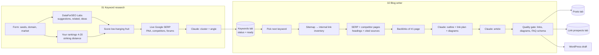

# Blog automation (OpenSEO-style) for n8n

Two separate n8n workflows that rebuild the blog automation on the same data source and approach as [OpenSEO](https://github.com/every-app/open-seo) (DataForSEO + an AI agent), but running inside our own n8n:

| Workflow | What it does | Output |
| --- | --- | --- |
| `workflows/01-keyword-research.json` | Seeds → low-hanging-fruit keywords + the questions people ask → positioning per keyword | **Keywords** tab (the backlog) |
| `workflows/02-blog-writer.json` | Takes the best `ready` keyword → research → outline → full article with internal links, external links and diagrams | **Posts** tab, **Link prospects** tab, optional WordPress draft |

Research and writing are deliberately separate: run workflow 1 when you want new topics, and let workflow 2 work through the backlog on its schedule (Mon + Thu 07:45).



## How "low-hanging fruit" is decided

Each keyword gets an opportunity score:

`√volume × difficulty factor × intent weight × CPC bonus × striking-distance bonus × question bonus`

- **Difficulty factor**: `((100 − KD) / 100)²`, so easy keywords count far more.
- **Intent weight**: commercial 1.3, transactional 1.15, informational 1, navigational 0.3.
- **Striking distance**: you already rank 4–20, so the score is doubled and difficulty matters less.

A keyword counts as low-hanging fruit when either:

- you already rank 4–20 for it, or
- its KD is at most the form's max (default 30) and its volume is at least the form's minimum (default 20).

Keywords that share no word with your seeds are dropped, and so are keywords containing a competitor's brand name. The best N keywords then get a live SERP check. A SERP counts as **weak** when the top 10 has two or more forum/UGC results (Reddit, Quora, Medium, …) or KD ≤ 15.

Questions come from three places:

- question-style keywords (EN/NL/DE/FR question words)
- People Also Ask
- related searches

Claude merges them into `questions_to_answer` for each keyword.

## How the article is built

1. **Internal links**: the sitemap (sitemap indexes are followed) gives every real page on the site. For the pages most related to the topic, the workflow reads the title and meta description. Claude can only pick from this list. Any internal link that isn't in it is removed again after writing.
2. **External links**: the workflow reads the top 5 ranking pages and collects the sources *they* cite. Authority domains (.gov, .edu, CBS, Rijksoverheid, Wikipedia, …) come first, and social, UGC and competitor domains are excluded. Every link is checked after writing, and 404s and dead domains are removed.
3. **Backlinks**: DataForSEO Backlinks lists the dofollow domains linking to the #1 result. These go to **Link prospects** as an outreach list for after you publish.
4. **Diagrams**: Claude plans 1–2 Mermaid diagrams. Each one is rendered with mermaid.ink. Diagrams that don't render are dropped. `markdown_for_cms` and `html` contain them as images. `markdown` keeps the Mermaid source.
5. **Quality gate**: word count, link counts and FAQPage JSON-LD (built from the FAQ section). If anything was removed or the article is short, the post gets `needs-review` instead of `draft-ready`, and `issues` lists what happened.

## Setup

1. **Credentials** (n8n → Credentials):
   - `DataForSEO`: type **Basic Auth**. User = your DataForSEO login, password = your API password (dataforseo.com → API Access). Labs + SERP are pay-as-you-go. The Backlinks API needs its own DataForSEO Backlinks subscription. Without it that one node fails softly and **Link prospects** stays empty.
   - `Anthropic`: your Claude API key.
   - `Google Sheets`: OAuth2.
   - `WordPress` (optional): only if you enable the **Create WordPress draft** node.
2. **Google Sheet**: create one spreadsheet with three empty tabs named exactly `Keywords`, `Posts` and `Link prospects`. The headers are written automatically on the first run.
3. **Import** both JSON files (n8n → Workflows → Import from file), open each **Config** node and fill in:
   - `SHEET_ID`: the long id in the sheet URL.
   - `BUSINESS_DESCRIPTION`, `BRAND_VOICE`, `SITE_URL`, `SITEMAP_URL`, `LANGUAGE`, `LOCATION_NAME`.
   - `CLAUDE_MODEL`: defaults to `claude-sonnet-5-5`. Use `claude-opus-5-5` for higher-quality articles at a higher cost.
   - `TARGET_WORDS`, plus link counts.
4. Select the credentials on the nodes that show a warning, then:
   - Run workflow 1 via its form (open the form's test URL, or activate the workflow for the production URL).
   - Run workflow 2 with **Run now** or activate it for the schedule.
   - To write about a specific backlog keyword, put it in `KEYWORD_OVERRIDE`.

### Rough cost per run

DataForSEO list prices at the time of writing; check your dashboard.

- **Keyword research**: about $0.10–0.30 for 2–3 seeds and 10 SERP checks, plus one Claude call.
- **Article**: about $0.01 for the SERP, $0.02+ for backlinks (if subscribed), plus two Claude calls.

## Editing the workflows

The Code-node logic lives in `src/code/*.js`; `build.mjs` assembles the workflow JSON from it.

```bash
node blog-automation/build.mjs           # regenerate workflows/*.json
node blog-automation/test/run-tests.mjs  # run every Code node against mocked DataForSEO/Claude/site data
```

If you edit a workflow in the n8n UI instead, export it over the JSON file. The `.js` sources will then be out of date until you copy the changes back.
